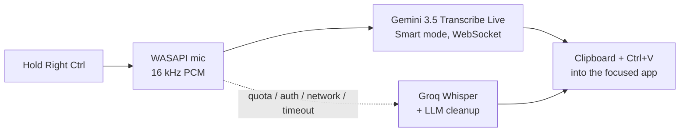
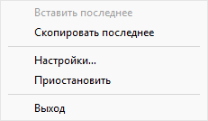
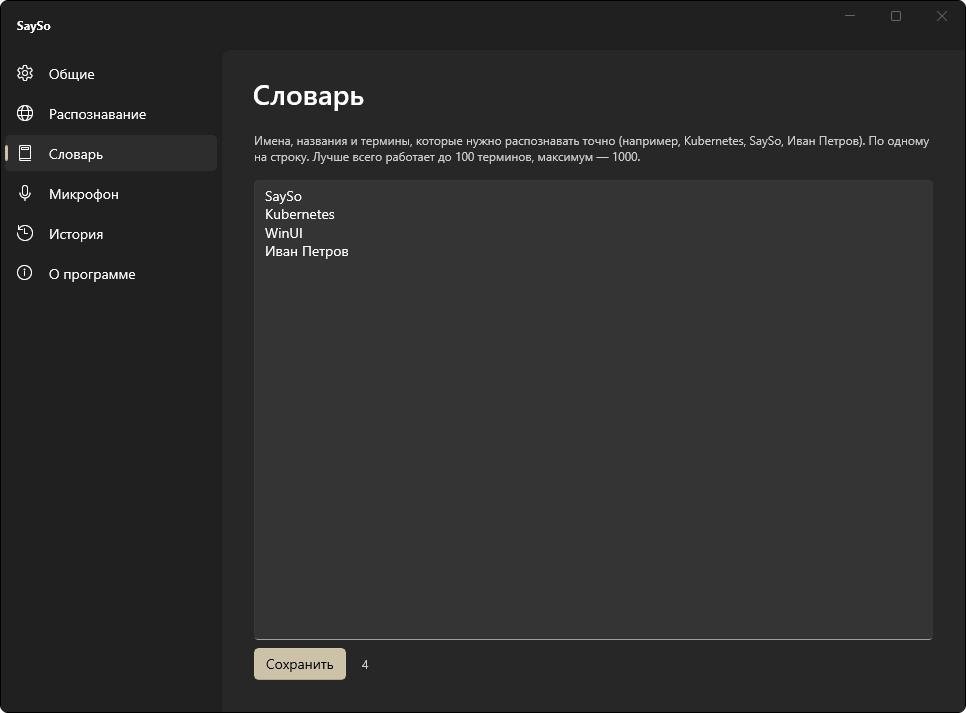
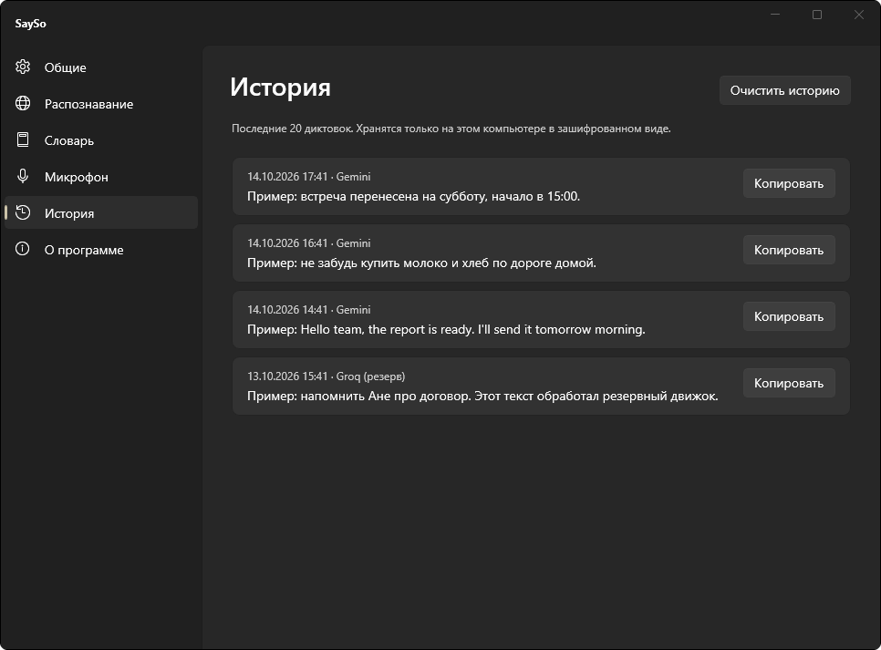
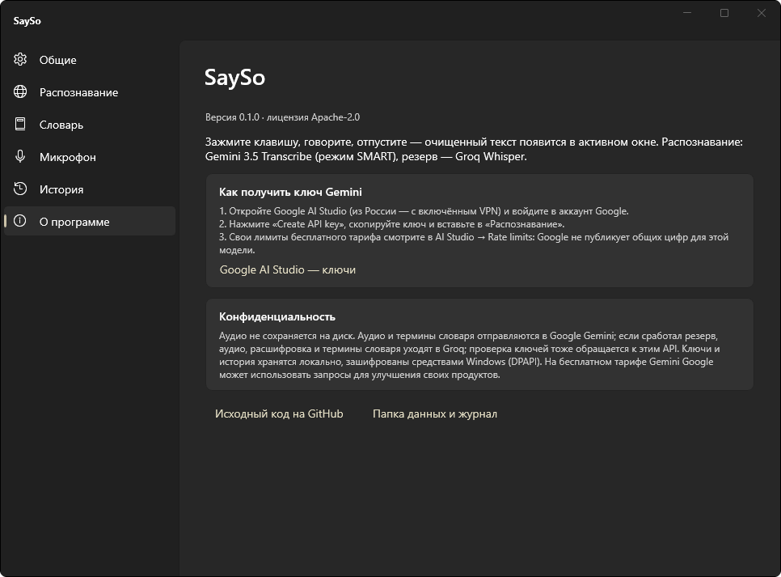
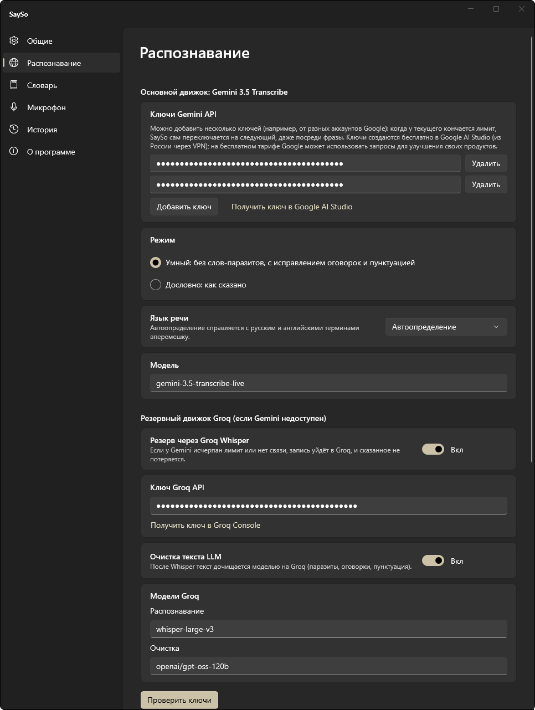
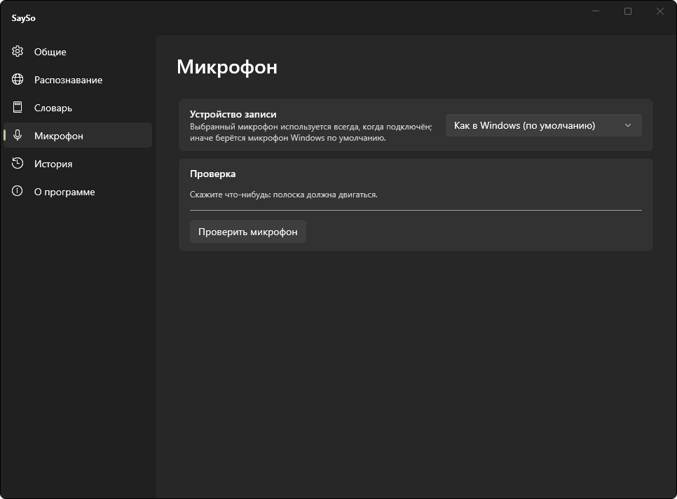
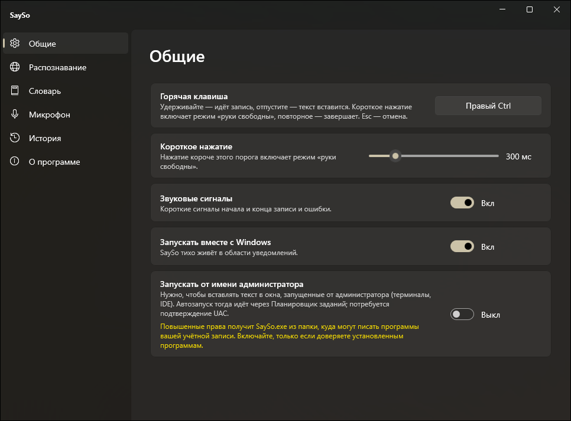

<p align="center"></p>
<h1 align="center">SaySo</h1>
<p align="center">
  <b>Hold a key. Speak. Get clean text in any Windows app.</b><br>
  Native Windows 11 voice dictation — a lightweight, free alternative to Wispr Flow.
</p>
<p align="center">
  <a href="https://github.com/Denmurzik/SaySo/actions/workflows/ci.yml"></a>
  
  
  
  <a href="LICENSE"></a>
</p>
<p align="center"><a href="README.ru.md">🇷🇺 Читать на русском</a></p>
<p align="center"></p>

## Why SaySo

- **Smart, not verbatim.** Speech is transcribed by **Gemini 3.5 Transcribe** in *Smart* («Умный») mode: filler words are removed, self-corrections are resolved (*“Friday — no, Saturday”* → *“Saturday”*), punctuation, casing and numbers are formatted.
- **Tiny in the background.** A NativeAOT daemon that never loads XAML: **6.9 MB** of private memory at idle (its working set is trimmed to under 1 MB). The WinUI 3 settings window is a separate process that fully exits when you close it.
- **Never loses what you said.** Add several Gemini keys and SaySo switches to the next one the moment a key hits its quota — even mid-sentence, re-sending what was already recorded. No keys left or network down? The recording goes to **Groq Whisper** with LLM cleanup instead.
- **Works everywhere.** Pastes into whatever app is focused; your clipboard text is restored and dictations are kept out of Win+V history.
- **Private by default.** Audio never touches the disk. API keys and history are encrypted with Windows DPAPI. Data flow: audio and your vocabulary terms go to Google Gemini; if the fallback kicks in, audio, the transcript and your vocabulary terms go to Groq; checking API keys also calls these APIs. The update check calls the GitHub API (see [Updates](#updates); it can be turned off).
- **Russian interface.** The app's interface is currently in Russian; the Russian labels of settings pages, buttons and menu items are given in parentheses throughout this README.

## How it works



| Action | What happens |
|---|---|
| Hold **Right Ctrl** | Recording while held; text is pasted when released |
| Tap **Right Ctrl** | Hands-free mode; tap again to finish |
| **Esc** while recording | Cancel, nothing is pasted |
| Tray → *Paste last* («Вставить последнее») / *Copy last* («Скопировать последнее») | Recover the last dictation |

The hotkey, language, model, vocabulary and microphone are configurable.

## Screenshots

### Overlay and tray

The overlay is drawn by the same renderer the app uses (the animation at the top shows recording, then processing). Error and info messages are one short line; the full text of an error is in the tray icon's tooltip. The overlay always stays on top of other windows (including other "always on top" ones) without taking focus; the Start menu and system flyouts stay above it, which a normal app cannot change. If a recording contains no speech (silence, too short, or an empty result), the overlay shows the info message «Речь не распознана» ("Speech not recognized"), with no error sound, and nothing is pasted or saved to history. If the microphone drops out mid-recording and nothing was captured, the microphone error is shown instead.

| State | Overlay |
|---|---|
| Recording — the bars follow your voice |  |
| Processing — the text is being recognized and cleaned up |  |
| Error — for example, the key hit its limit and no fallback is set up |  |
| Info — for example, the text came from the Groq fallback |  |

The tray menu (right-click the icon):



### Settings

<table>
<tr>
<td align="center" valign="top"><a href="docs/assets/settings-dictionary.png"></a><br><sub>Dictionary («Словарь»): names and terms to recognize exactly</sub></td>
<td align="center" valign="top"><a href="docs/assets/settings-history.png"></a><br><sub>History («История»): the last 20 dictations</sub></td>
</tr>
<tr>
<td align="center" valign="top" colspan="2"><a href="docs/assets/settings-about.png"></a><br><sub>About («О программе»): version, how to get a key, privacy</sub></td>
</tr>
</table>

The other pages are shown next to their descriptions: General («Общие») under [Admin mode](#admin-mode-optional), Recognition («Распознавание») under [API keys](#api-keys), Microphone («Микрофон») under [Microphone](#microphone). Click an image to open it full size. API keys and history in the screenshots are demo placeholders.

## Install

Requirements: Windows 11 x64, a microphone, a Gemini API key (free tier) and optionally a Groq API key (free) for the fallback.

### Installer (recommended)

1. Download `SaySo-Setup-X.Y.Z.exe` from the [latest release](https://github.com/Denmurzik/SaySo/releases/latest) and run it.
2. The installer is not code-signed, so on first launch Windows SmartScreen may show “Windows protected your PC”. Click *More info* («Подробнее») → *Run anyway* («Выполнить в любом случае»). To verify the download, compare `(Get-FileHash .\SaySo-Setup-X.Y.Z.exe).Hash` with the contents of `SaySo-Setup-X.Y.Z.exe.sha256` from the same release.
3. Pick the install mode in the wizard:
   - **Only for me** (default) — no administrator rights needed; SaySo goes to `%LOCALAPPDATA%\Programs\SaySo`.
   - **For all users** — installs to `C:\Program Files\SaySo` and asks for administrator rights (UAC).
4. Optionally add a desktop shortcut and tick *Launch SaySo*. The Start menu shortcut is always created. The wizard is in Russian, and in English when the Windows display language is English.

Installing a newer `SaySo-Setup` over an older one updates in place: the running SaySo is closed, settings, keys and history are kept. For scripted installs: `SaySo-Setup-X.Y.Z.exe /VERYSILENT /SUPPRESSMSGBOXES /NORESTART /CURRENTUSER` (or `/ALLUSERS`); a silent install does not start SaySo. In the *for all users* mode the installer closes only the SaySo of the user who runs it: copies running in other Windows sessions are not stopped, so some files may stay locked — sign those users out (or restart the PC) and run the installer again.

**Portable.** Every release also has `SaySo-X.Y.Z-win-x64.zip`: unpack it anywhere and run `SaySo.exe`. A copy that was not installed by the installer cannot update itself: the button on the About page becomes *Open release page* («Открыть страницу релиза») and opens the release page.

**Uninstall:** *Settings → Apps → Installed apps → SaySo → Uninstall*. The uninstaller stops SaySo, removes the autostart entry and the Task Scheduler task if they point to this installation, and asks whether to delete settings, keys and history too (`%LOCALAPPDATA%\SaySo`; the default answer is *No*, and a silent uninstall keeps them). The Task Scheduler task of the admin mode can only be removed with administrator rights: the uninstaller first offers a UAC prompt for it and, if you decline or it fails, shows the `schtasks /Delete /TN SaySo /F` command to run yourself from an elevated command prompt.

### Updates

SaySo checks GitHub Releases for a newer version and can install it in one click.

- **When it checks.** Automatically, if *General → Check for updates automatically* («Общие» → «Проверять обновления автоматически») is on (the default; the setting is `checkForUpdates` in `settings.json`) and at least 24 hours have passed since the last check (its time and the dismissed version are kept in `%LOCALAPPDATA%\SaySo\update-state.json`). The checks are triggered by events: 60 seconds after SaySo starts, 15 seconds after you unlock the session and 15 seconds after the PC wakes from sleep. There are no timers while it idles; a check that failed for lack of a network is repeated at the next such event. While you are dictating, the check, the download and the installer start wait for the end of the session.
- **Manual check.** *About → Check for updates* («О программе» → «Проверить обновления») checks right away and shows «Установлена последняя версия», or «Доступна версия X.Y.Z» with the release notes (the first 500 characters), or the reason of a failure (no connection to GitHub, no answer within 15 seconds, request limit).
- **When a new version is found.** A tray notification «Доступна версия X.Y.Z. Нажмите, чтобы обновить», the item «Обновить до X.Y.Z» at the top of the tray menu and the *Update* («Обновить») button on the About page. Closing the notification or letting it time out counts as a refusal: SaySo does not pop it up again for that version, while the menu item and the About page stay. If Windows swallowed the notification (Focus assist / Do not disturb), it appears again at the next daily check.
- **One click.** Click the notification, the menu item or the button: SaySo downloads `SaySo-Setup-X.Y.Z.exe` into `%TEMP%\SaySo-Update`, checks its size and SHA-256 against the `.sha256` file of the same release (on a mismatch it deletes the file and starts nothing), starts the installer silently and waits for it. The installer closes SaySo itself, installs over the old version and starts SaySo again as the original user. The mode is the one you installed in, read from the installer's uninstall entry: *only for me* updates without any prompt; for *for all users* the installer itself asks Windows for administrator rights (UAC) — if you decline, SaySo shows «Обновление отменено» and keeps running. A failed update rolls back, and the previous SaySo is started again.
- **When SaySo cannot install by itself.** If SaySo runs as administrator (admin mode), if the copy was not installed by the installer (the ZIP, `install.ps1`) or if the release has no installer files, nothing is downloaded or started: the notification reads «Доступна версия X.Y.Z. Скачайте установщик со страницы релиза», the menu item becomes «Страница релиза X.Y.Z», the About button «Открыть страницу релиза», and they open the release page — install the new version by hand.
- **What leaves your PC.** One request `GET https://api.github.com/repos/Denmurzik/SaySo/releases/latest` (headers `User-Agent: SaySo/<version>` and `Accept: application/vnd.github+json`, no token, 15 s timeout) and the download of the installer and its `.sha256` from `github.com/Denmurzik/SaySo/releases/…`. As with any web request, GitHub sees your IP address. Keys, texts and audio are not sent.
- **Diagnostics.** `SaySo.exe --check-updates --out result.txt` makes one check without the daemon, windows or tray and writes one line to the file: `current=0.1.2 outcome=UpToDate`, `outcome=Available latest=X.Y.Z installable=True|False …` or `outcome=Failed failure=Network|Timeout|RateLimited|BadResponse`. Exit code: 0 — the check was made, 2 — it failed, 3 — unexpected error. `--out` is needed because `SaySo.exe` has no console window. The command does not change `update-state.json` or `settings.json`.

### Build from source

For development: needs the .NET 10 SDK and Visual Studio Build Tools with the C++ workload for NativeAOT.

```powershell
git clone https://github.com/Denmurzik/SaySo
cd SaySo
powershell -ExecutionPolicy Bypass -File .\build.ps1             # NativeAOT publish to artifacts/publish; needs >= 4 GB of free RAM
powershell -ExecutionPolicy Bypass -File .\install.ps1           # copies to %LOCALAPPDATA%\Programs\SaySo, adds a Start menu shortcut, starts SaySo
powershell -ExecutionPolicy Bypass -File .\build-installer.ps1   # builds artifacts/installer/SaySo-Setup-X.Y.Z.exe (+ .sha256) and the portable ZIP
```

Uninstall a copy made by `install.ps1`: `powershell -ExecutionPolicy Bypass -File .\uninstall.ps1` (add `-RemoveData` to also delete settings, keys and history). Both scripts accept `-Target <folder>` and `-WhatIf`. `build-installer.ps1` uses an installed Inno Setup 6.3+ if it finds one; otherwise it downloads the portable compiler (the `Tools.InnoSetup` NuGet package) into `artifacts/tools` and installs nothing system-wide. Releases are built by GitHub Actions when a `vX.Y.Z` tag is pushed (the tag must match `<Version>` in `Directory.Build.props`).

For development and screenshots, the environment variable `SAYSO_DATA_DIR` (an absolute path; a relative one is ignored) makes SaySo keep its settings, keys, history and log in that folder instead of `%LOCALAPPDATA%\SaySo`, so the real data stays untouched.

## API keys

- **Gemini** — create a key in [Google AI Studio](https://aistudio.google.com/apikey). Your own free-tier limits are shown in AI Studio (Google does not publish fixed numbers for this preview model). On the free tier Google may use requests to improve its products. The Gemini API is not available in some regions (including Russia) — a system-wide VPN is required there.
- **Groq** (optional fallback) — create a key in the [Groq Console](https://console.groq.com/keys).

Paste the keys into *Settings → Recognition* («Распознавание») (you can add several Gemini keys) and press *Check keys* («Проверить ключи»). Keys are shown masked.

<p align="center"></p>

Windows must allow desktop apps to use the microphone: *Settings → Privacy & security → Microphone*.

## Settings

Open them from the tray icon (double-click, or right-click → *Settings…* («Настройки…»)). The window is titled “SaySo” and has a side menu that is always open: General («Общие»), Recognition («Распознавание»), Dictionary («Словарь»), Microphone («Микрофон»), History («История»), About («О программе»). The window is a separate process: closing it ends it.

### Sounds

SaySo plays a short signal when recording starts, when it ends and when something goes wrong. *General → Sounds* («Общие» → «Звуки») offers eight themes: Glass («Стекло»), Drop («Капля»), Wood («Дерево»), Bell («Колокольчик»), Felt («Войлок», the default), Pillow («Подушка»), Tap («Тап») and Kalimba («Калимба»). The *Preview* («Прослушать») button plays the start signal of the chosen theme. The choice is saved at once and applies to the running SaySo without a restart; the *Sound signals* («Звуковые сигналы») switch turns every signal off. The sounds are built into `SaySo.exe` (about 2 MB) and generated by `tools/sounds/generate_sounds.py`. They are played straight from the executable's memory, so no extra private memory is held.

### Microphone

SaySo remembers the microphone you pick. A chosen headset is used automatically whenever it is connected again: it is matched by device Id, and by name if Windows gave it a new Id after you plugged it into another USB port. While it is unplugged, dictation uses the Windows default microphone. An explicitly chosen built-in microphone stays selected even when a headset is connected. *Same as Windows (default)* («Как в Windows (по умолчанию)») always follows the Windows default device. *Check microphone* («Проверить микрофон») shows a live level bar.

<p align="center"></p>

### Admin mode (optional)

Windows does not let a normal app paste into windows running as administrator (elevated terminals, some IDEs): SaySo leaves the text on the clipboard and says so on the overlay. *General → Run as administrator* («Общие» → «Запускать от имени администратора») lifts this: SaySo is then started at logon by a Task Scheduler task with the highest privileges (one UAC prompt when you switch it on). Admin mode launches `SaySo.exe` elevated from its install folder, which is writable by programs running under your account — enable it only if you trust the software on this PC (the switch has the same warning next to it).

<p align="center"></p>

## Memory footprint

Measured on Windows 11 (x64), NativeAOT Release build:

| Process | Private bytes | Working set |
|---|---|---|
| Daemon, idle after start | 6.9 MB | 0.2 MB |
| Daemon, 10 s after a 1.5 s recording (placeholder API keys, without a completed recognition) | 8.8 MB | 0.3 MB |
| Settings window (open, 6 s after launch) | 93.4 MB | 147.5 MB |
| Settings window (closed) | process exits | process exits |

Publish size: 68.9 MB (`SaySo.exe` is 11.9 MB, of which about 2 MB are the built-in sounds). All sizes here are in mebibytes (1 MB = 1,048,576 bytes), the way `build.ps1` and the measuring scripts print them.

The daemon trims its working set after start and after each session, so its working set stays below 1 MB and *Private bytes* is the more telling column; the settings window is not trimmed. The dictation row was measured without a completed recognition: a real dictation adds network buffers (WebSocket/TLS/HTTP), so expect somewhat more.

## Build & test

```powershell
dotnet test --project tests/SaySo.Core.Tests --filter-not-trait "Category=Integration"   # unit tests
dotnet test --project tests/SaySo.Core.Tests --filter-trait "Category=Integration"       # mic / clipboard / hook
dotnet run --project tools/SaySo.Probe -- gemini --wav <file.wav> --realtime            # raw protocol probe
```

Architecture, decisions and the protocol notes: [`docs/superpowers/specs`](docs/superpowers/specs), [`docs/protocol-notes.md`](docs/protocol-notes.md).

## Roadmap

Command mode (edit selected text by voice), per-app styles, snippets, local models, MSIX package, ARM64.

## License

SaySo is free software: you can redistribute it and/or modify it under the terms of the GNU General Public License as published by the Free Software Foundation, either version 3 of the License or (at your option) any later version ([GPL-3.0-or-later](LICENSE)). It comes with no warranty. Version 0.1.0 was released under Apache-2.0.
