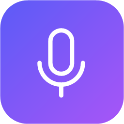
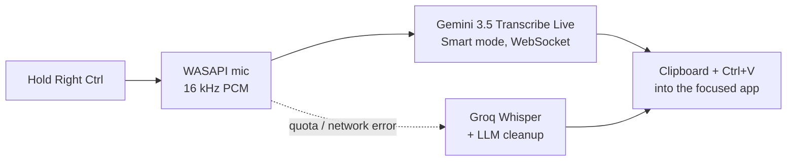

<p align="center"></p>
<h1 align="center">SaySo</h1>
<p align="center">
  <b>Hold a key. Speak. Get clean text in any Windows app.</b><br>
  Native Windows 11 voice dictation — a lightweight, free alternative to Wispr Flow.
</p>
<p align="center">
  <a href="https://github.com/Denmurzik/SaySo/actions/workflows/ci.yml"></a>
  
  
  
  <a href="LICENSE"></a>
</p>
<p align="center"><a href="README.ru.md">🇷🇺 Читать на русском</a></p>
<p align="center"></p>

## Why SaySo

- **Smart, not verbatim.** Speech is transcribed by **Gemini 3.5 Transcribe** in *Smart* mode: filler words are removed, self-corrections are resolved (*“Friday — no, Saturday”* → *“Saturday”*), punctuation, casing and numbers are formatted.
- **Tiny in the background.** A NativeAOT daemon that never loads XAML: **{idleWs} MB** working set at idle (**{idlePrivate} MB** private). The WinUI 3 settings window is a separate process that fully exits when you close it.
- **Never loses what you said.** Add several Gemini keys and SaySo switches to the next one the moment a key hits its quota — even mid-sentence, re-sending what was already recorded. No keys left or network down? The recording goes to **Groq Whisper** with LLM cleanup instead.
- **Works everywhere.** Pastes into whatever app is focused; your clipboard text is restored and dictations are kept out of Win+V history.
- **Private by default.** Audio never touches the disk. API keys and history are encrypted with Windows DPAPI.

## How it works



| Action | What happens |
|---|---|
| Hold **Right Ctrl** | Recording while held; text is pasted when released |
| Tap **Right Ctrl** | Hands-free mode; tap again to finish |
| **Esc** while recording | Cancel, nothing is pasted |
| Tray → *Paste last* / *Copy last* | Recover the last dictation |

The hotkey, language, model, vocabulary and microphone are configurable.

## Install

Requirements: Windows 11 x64, a microphone, a Gemini API key (free tier) and optionally a Groq API key (free) for the fallback.

Build from source (needs the .NET 10 SDK and Visual Studio Build Tools with the C++ workload for NativeAOT):

```powershell
git clone https://github.com/Denmurzik/SaySo
cd SaySo
./build.ps1      # NativeAOT publish to artifacts/publish
./install.ps1    # copies to %LOCALAPPDATA%\Programs\SaySo, adds a Start menu shortcut, starts SaySo
```

Uninstall: `./uninstall.ps1` (add `-RemoveData` to also delete settings, keys and history).

## API keys

- **Gemini** — create a key in [Google AI Studio](https://aistudio.google.com/apikey). Your own free-tier limits are shown in AI Studio (Google does not publish fixed numbers for this preview model). On the free tier Google may use requests to improve its products. The Gemini API is not available in some regions (including Russia) — a system-wide VPN is required there.
- **Groq** (optional fallback) — create a key in the [Groq Console](https://console.groq.com/keys).

Paste the keys into *Settings → Recognition* (you can add several Gemini keys) and press *Check keys*.

Windows must allow desktop apps to use the microphone: *Settings → Privacy & security → Microphone*.

## Memory footprint

Measured on Windows 11 (x64), NativeAOT Release build:

| Process | Working set | Private bytes |
|---|---|---|
| Daemon, idle after start | {idleWs} MB | {idlePrivate} MB |
| Daemon, 10 s after a dictation | {afterWs} MB | {afterPrivate} MB |
| Settings window (open) | {settingsWs} MB | {settingsPrivate} MB |
| Settings window (closed) | process exits | — |

Publish size: {publishMb} MB.

<p align="center"></p>

## Build & test

```powershell
dotnet test --project tests/SaySo.Core.Tests --filter-not-trait "Category=Integration"   # unit tests
dotnet test --project tests/SaySo.Core.Tests --filter-trait "Category=Integration"       # mic / clipboard / hook
dotnet run --project tools/SaySo.Probe -- gemini --wav <file.wav> --realtime            # raw protocol probe
```

Architecture, decisions and the protocol notes: [`docs/superpowers/specs`](docs/superpowers/specs), [`docs/protocol-notes.md`](docs/protocol-notes.md).

## Roadmap

Command mode (edit selected text by voice), per-app styles, snippets, local models, MSIX package, ARM64.

## License

[Apache-2.0](LICENSE)
