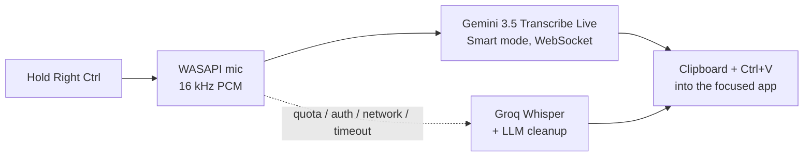

<p align="center"></p>
<h1 align="center">SaySo</h1>
<p align="center">
  <b>Hold a key. Speak. Get clean text in any Windows app.</b><br>
  Native Windows 11 voice dictation — a lightweight, free alternative to Wispr Flow.
</p>
<p align="center">
  <a href="https://github.com/Denmurzik/SaySo/actions/workflows/ci.yml"></a>
  
  
  
  <a href="LICENSE"></a>
</p>
<p align="center"><a href="README.ru.md">🇷🇺 Читать на русском</a></p>
<p align="center"></p>

## Why SaySo

- **Smart, not verbatim.** Speech is transcribed by **Gemini 3.5 Transcribe** in *Smart* («Умный») mode: filler words are removed, self-corrections are resolved (*“Friday — no, Saturday”* → *“Saturday”*), punctuation, casing and numbers are formatted.
- **Tiny in the background.** A NativeAOT daemon that never loads XAML: **6.9 MB** of private memory at idle (its working set is trimmed to under 1 MB). The WinUI 3 settings window is a separate process that fully exits when you close it.
- **Never loses what you said.** Add several Gemini keys and SaySo switches to the next one the moment a key hits its quota — even mid-sentence, re-sending what was already recorded. No keys left or network down? The recording goes to **Groq Whisper** with LLM cleanup instead.
- **Works everywhere.** Pastes into whatever app is focused; your clipboard text is restored and dictations are kept out of Win+V history.
- **Private by default.** Audio never touches the disk. API keys and history are encrypted with Windows DPAPI. Data flow: audio and your vocabulary terms go to Google Gemini; if the fallback kicks in, audio, the transcript and your vocabulary terms go to Groq; checking API keys also calls these APIs.
- **Russian interface.** The app's interface is currently in Russian; the Russian labels of settings pages, buttons and menu items are given in parentheses throughout this README.

## How it works



| Action | What happens |
|---|---|
| Hold **Right Ctrl** | Recording while held; text is pasted when released |
| Tap **Right Ctrl** | Hands-free mode; tap again to finish |
| **Esc** while recording | Cancel, nothing is pasted |
| Tray → *Paste last* («Вставить последнее») / *Copy last* («Скопировать последнее») | Recover the last dictation |

The hotkey, language, model, vocabulary and microphone are configurable.

## Screenshots

### Overlay and tray

The overlay is drawn by the same renderer the app uses (the animation at the top shows recording, then processing). Error and info messages are one short line; the full text of an error is in the tray icon's tooltip.

| State | Overlay |
|---|---|
| Recording — the bars follow your voice |  |
| Processing — the text is being recognized and cleaned up |  |
| Error — for example, the key hit its limit and no fallback is set up |  |
| Info — for example, the text came from the Groq fallback |  |

The tray menu (right-click the icon):


### Settings

<table>
<tr>
<td align="center" valign="top"><a href="docs/assets/settings-dictionary.png"></a><br><sub>Dictionary («Словарь»): names and terms to recognize exactly</sub></td>
<td align="center" valign="top"><a href="docs/assets/settings-history.png"></a><br><sub>History («История»): the last 20 dictations</sub></td>
</tr>
<tr>
<td align="center" valign="top" colspan="2"><a href="docs/assets/settings-about.png"></a><br><sub>About («О программе»): version, how to get a key, privacy</sub></td>
</tr>
</table>

The other pages are shown next to their descriptions: General («Общие») under [Admin mode](#admin-mode-optional), Recognition («Распознавание») under [API keys](#api-keys), Microphone («Микрофон») under [Microphone](#microphone). Click an image to open it full size. API keys and history in the screenshots are demo placeholders.

## Install

Requirements: Windows 11 x64, a microphone, a Gemini API key (free tier) and optionally a Groq API key (free) for the fallback.

Build from source (needs the .NET 10 SDK and Visual Studio Build Tools with the C++ workload for NativeAOT):

```powershell
git clone https://github.com/Denmurzik/SaySo
cd SaySo
powershell -ExecutionPolicy Bypass -File .\build.ps1     # NativeAOT publish to artifacts/publish; needs >= 4 GB of free RAM
powershell -ExecutionPolicy Bypass -File .\install.ps1   # copies to %LOCALAPPDATA%\Programs\SaySo, adds a Start menu shortcut, starts SaySo
```

Uninstall: `powershell -ExecutionPolicy Bypass -File .\uninstall.ps1` (add `-RemoveData` to also delete settings, keys and history). Both install scripts accept `-Target <folder>` and `-WhatIf`.

## API keys

- **Gemini** — create a key in [Google AI Studio](https://aistudio.google.com/apikey). Your own free-tier limits are shown in AI Studio (Google does not publish fixed numbers for this preview model). On the free tier Google may use requests to improve its products. The Gemini API is not available in some regions (including Russia) — a system-wide VPN is required there.
- **Groq** (optional fallback) — create a key in the [Groq Console](https://console.groq.com/keys).

Paste the keys into *Settings → Recognition* («Распознавание») (you can add several Gemini keys) and press *Check keys* («Проверить ключи»). Keys are shown masked.

<p align="center"></p>

Windows must allow desktop apps to use the microphone: *Settings → Privacy & security → Microphone*.

## Settings

Open them from the tray icon (double-click, or right-click → *Settings…* («Настройки…»)). The window is titled “SaySo” and has a side menu that is always open: General («Общие»), Recognition («Распознавание»), Dictionary («Словарь»), Microphone («Микрофон»), History («История»), About («О программе»). The window is a separate process: closing it ends it.

### Microphone

SaySo remembers the microphone you pick. A chosen headset is used automatically whenever it is connected again: it is matched by device Id, and by name if Windows gave it a new Id after you plugged it into another USB port. While it is unplugged, dictation uses the Windows default microphone. An explicitly chosen built-in microphone stays selected even when a headset is connected. *Same as Windows (default)* («Как в Windows (по умолчанию)») always follows the Windows default device. *Check microphone* («Проверить микрофон») shows a live level bar.

<p align="center"></p>

### Admin mode (optional)

Windows does not let a normal app paste into windows running as administrator (elevated terminals, some IDEs): SaySo leaves the text on the clipboard and says so on the overlay. *General → Run as administrator* («Общие» → «Запускать от имени администратора») lifts this: SaySo is then started at logon by a Task Scheduler task with the highest privileges (one UAC prompt when you switch it on). Admin mode launches `SaySo.exe` elevated from its install folder, which is writable by programs running under your account — enable it only if you trust the software on this PC (the switch has the same warning next to it).

<p align="center"></p>

## Memory footprint

Measured on Windows 11 (x64), NativeAOT Release build:

| Process | Private bytes | Working set |
|---|---|---|
| Daemon, idle after start | 6.9 MB | 0.2 MB |
| Daemon, 10 s after a 1.5 s recording (placeholder API keys, without a completed recognition) | 8.8 MB | 0.3 MB |
| Settings window (open, 6 s after launch) | 93.4 MB | 147.5 MB |
| Settings window (closed) | process exits | process exits |

Publish size: 66.6 MB (`SaySo.exe` is 9.6 MB).

The daemon trims its working set after start and after each session, so its working set stays below 1 MB and *Private bytes* is the more telling column; the settings window is not trimmed. The dictation row was measured without a completed recognition: a real dictation adds network buffers (WebSocket/TLS/HTTP), so expect somewhat more.

## Build & test

```powershell
dotnet test --project tests/SaySo.Core.Tests --filter-not-trait "Category=Integration"   # unit tests
dotnet test --project tests/SaySo.Core.Tests --filter-trait "Category=Integration"       # mic / clipboard / hook
dotnet run --project tools/SaySo.Probe -- gemini --wav <file.wav> --realtime            # raw protocol probe
```

Architecture, decisions and the protocol notes: [`docs/superpowers/specs`](docs/superpowers/specs), [`docs/protocol-notes.md`](docs/protocol-notes.md).

## Roadmap

Command mode (edit selected text by voice), per-app styles, snippets, local models, MSIX package, ARM64.

## License

[Apache-2.0](LICENSE)
